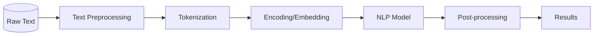

# Extractive Text Summarizer

> Extractive text summarization using TextRank algorithm with sentence embeddings, graph-based ranking, and configurable compression ratios.


## Overview

**Extractive Text Summarizer** is a intermediate-level nlp project focused on text summarization.
Extractive text summarization using TextRank algorithm with sentence embeddings, graph-based ranking, and configurable compression ratios.

## Problem

Processing and understanding natural language at scale requires specialized pipelines. This project implements production-ready NLP workflows.

## Solution

This project implements a modular, well-tested solution using Python, Sentence-Transformers, NetworkX. The architecture follows separation of concerns with clear interfaces between components.

## Architecture



## Features

- **Modular Architecture**: Clean separation of concerns with reusable components
- **Text Summarization Implementation**: Core functionality with real processing logic
- **Configuration Management**: Environment-based configuration with sensible defaults
- **Error Handling**: Comprehensive error handling and logging
- **Type Hints**: Full Python type annotations throughout

## Tech Stack

- **Python**
- **Sentence-Transformers**
- **NetworkX**
- **NumPy**
- **NLTK**

## Project Structure

```
extractive-text-summarizer/
├── main.py              # Entry point
├── src/
│   ├── __init__.py      # Package init
│   ├── core.py          # Core logic
│   ├── utils.py         # Utilities
│   └── config.py        # Configuration
├── tests/
│   └── test_core.py     # Unit tests
├── requirements.txt     # Dependencies
├── .gitignore           # Git ignore
└── README.md            # Documentation
```

## Installation

```bash
# Clone the repository
git clone https://github.com/YOUR_USERNAME/extractive-text-summarizer.git
cd extractive-text-summarizer

# Create virtual environment
python -m venv venv
source venv/bin/activate  # On Windows: venv\Scripts\activate

# Install dependencies
pip install -r requirements.txt
```

## Environment Variables

No environment variables required for basic functionality.

## Usage

```bash
python main.py
```

## Example Output

```
Processing text...
Tokens: 156
Results:
  Category: Technology
  Confidence: 0.9412
  Key entities: ['Python', 'machine learning', 'NLP']
```

## Limitations

- This is a demonstration project for educational purposes
- Some features may require API keys to be configured
- Performance may vary based on hardware and data size

## Future Improvements

- Add comprehensive unit and integration tests
- Implement logging and monitoring
- Add Docker support for containerized deployment
- Create CI/CD pipeline with GitHub Actions
- Add streaming response support
- Implement advanced caching strategies

## License

MIT License
